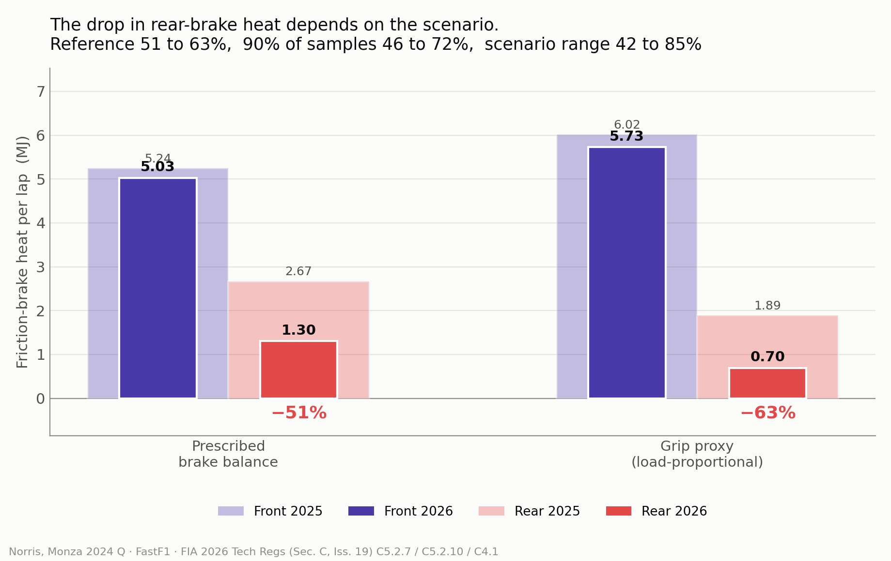
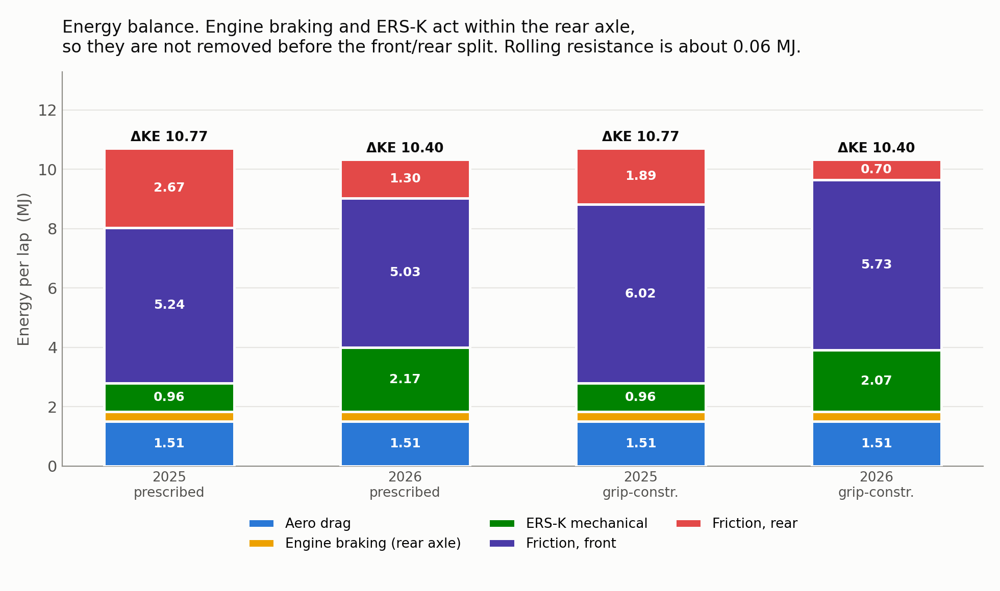
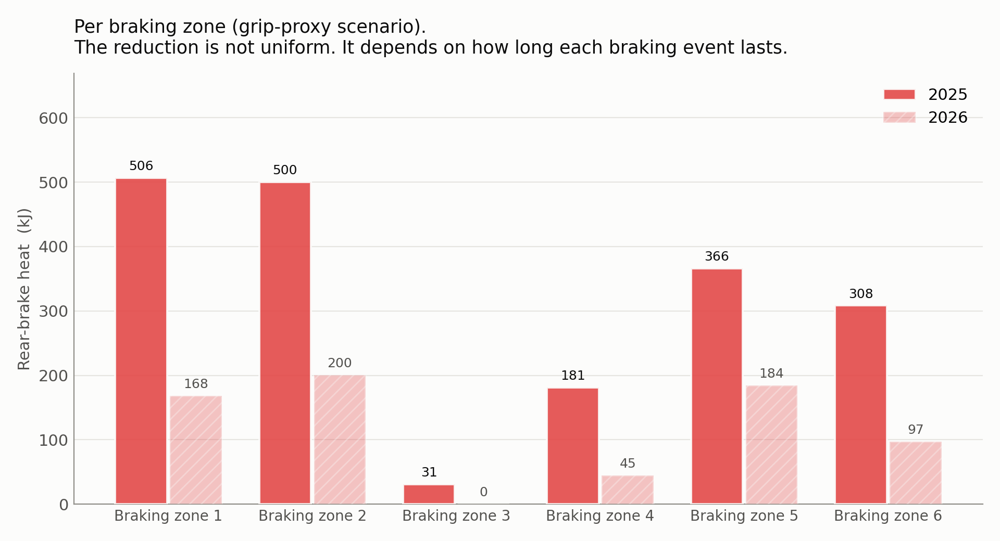
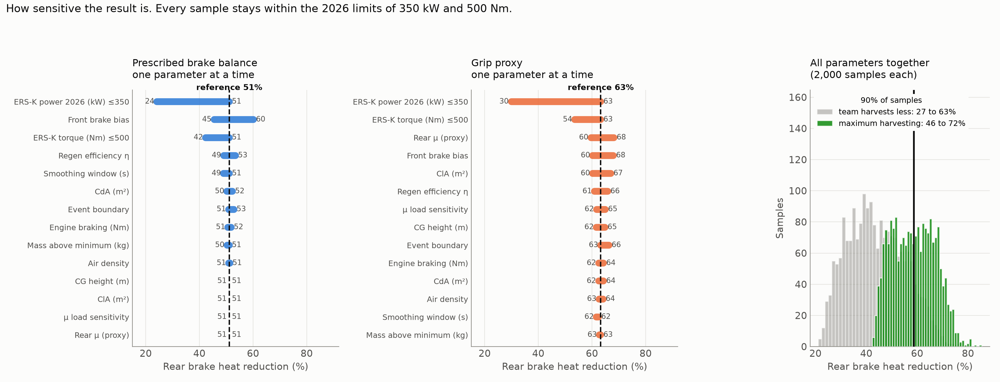
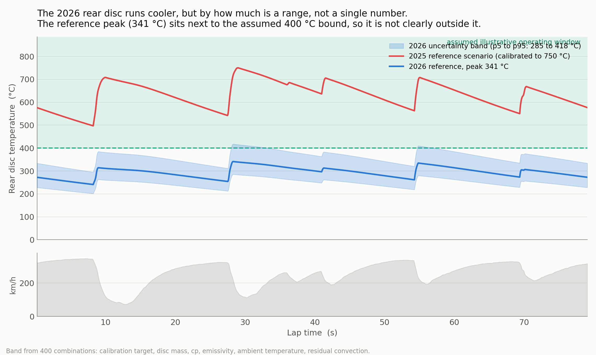
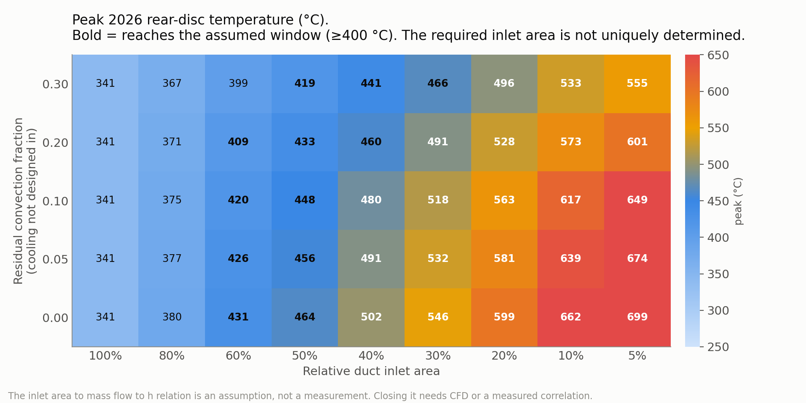
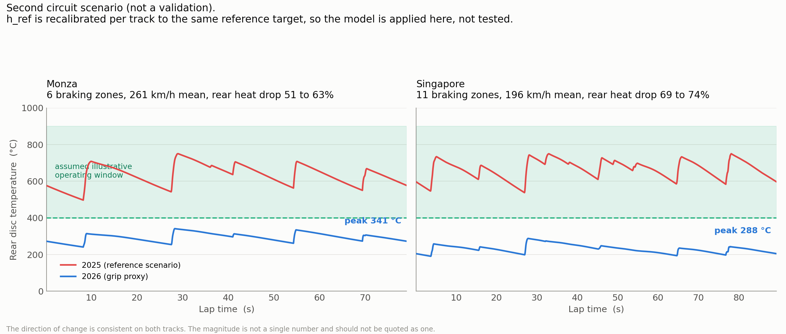
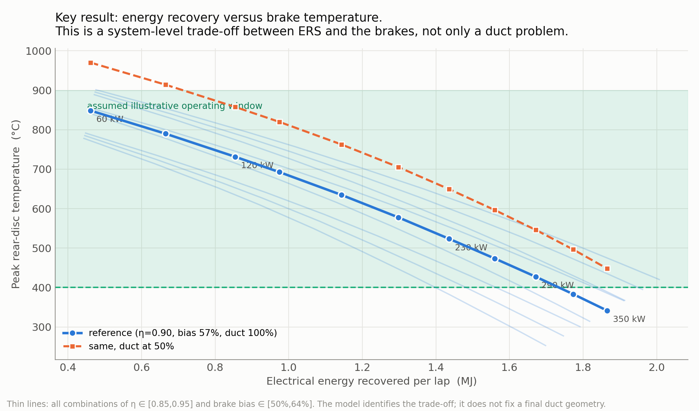
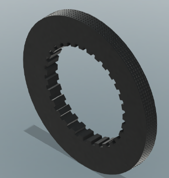
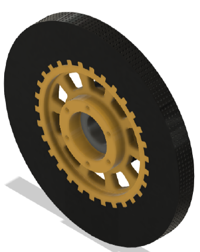

# F1 Rear Brake Energy and Thermal Study, 2026 Regulations

Ioanna Texakalidou, independent project, 2026

## The short version

In 2026 Formula 1 cars recover much more energy when they brake. The electric motor on the rear axle (the MGU-K) goes from 120 kW to 350 kW, so it slows the rear wheels much harder and turns that energy into electricity. The rear friction brakes are left with less to do, and they get less hot.

That sounds good, but carbon brakes need to be hot to work well. I wanted to know how much cooler the rear brakes will run in 2026, so I built a Python model from real lap data and the official 2026 rules. I started this project while preparing for McLaren Racing NEXT 2026.

**My answer:** the rear friction brakes take about half the heat they took before, 51% to 63% less on a qualifying lap at Monza. The rear disc peaks at roughly 340 °C to 410 °C, against the 750 °C I set as the 2025 reference. That is close to or below 400 °C, the lower end of the temperature range I assumed carbon brakes need. Cooling the rear brakes in 2026 is therefore not only a question of how big the cooling duct is. It is a trade-off between how much energy the car recovers and how hot the brakes stay.

The data sheets of the disc, the regulation values and every model input are in [TECHNICAL_DATA.md](TECHNICAL_DATA.md). The equations are in [FORMULAS.md](FORMULAS.md). How the code is built, and how I used AI, is in [HOW_IT_WAS_BUILT.md](HOW_IT_WAS_BUILT.md).

## Some background

When an F1 car brakes from 340 km/h to 100 km/h, its speed energy has to go somewhere. Part is taken by air resistance, part by the engine, part by the MGU-K, which turns it into electricity for the battery, and the rest becomes heat in the front and rear friction brakes.

The 2026 rules change that split. The MGU-K becomes almost three times as powerful and may recover up to 8.5 MJ per lap instead of 2 MJ. All of that happens on the rear axle, so the rear friction brakes lose most of their work while the front brakes hardly change.

Carbon brakes grip properly only when they are hot. If they run too cold, friction and wear become less predictable. That is why a cooler rear brake is not automatically good news.

## What I found

1. The rear brakes take 51% to 63% less heat. The two numbers come from two ways of dividing braking between front and rear (explained below the first figure). When I let every uncertain input vary together, 90% of the results fall between 46% and 72%.

2. The rear disc runs far cooler. There is no public brake temperature data, so I set the 2025 disc to peak at 750 °C as a reference and used the model to see what changes in 2026. The 2026 peak falls to 341 °C to 412 °C. With every uncertain input varied together, 90% of the results fall between 287 °C and 485 °C, and only about a third of them reach 400 °C.

3. The front brakes hardly change. The extra recovery happens on the rear axle only.

4. It is a trade-off, not just a duct problem. If the team recovers less energy, the rear disc gets hotter. Limiting the MGU-K to 200 kW, for example, raises the peak to about 580 °C but recovers 0.6 MJ less per lap. A smaller cooling duct also raises the temperature, but the model cannot say exactly how much without wind tunnel or CFD data.

5. The same happens at a slower track. At Singapore, with 11 braking zones, the rear brake heat drops even more, 69% to 74%.

## The figures explained

### Brake heat per lap, front and rear

Each pair of bars is the heat that goes into the front (purple) and rear (red) friction brakes on one lap, pale for 2025 and dark for 2026. The rear brakes drop by about half, the front brakes almost not at all.

The left and right groups are two ways of dividing the braking between front and rear. "Prescribed brake balance" keeps the split the driver sets, 57% front. "Grip proxy" lets the rear take only as much braking as its tyres can carry, which depends on how much weight is on them. The truth is probably somewhere in between, which is why I report both.

### Where the braking energy goes

Each bar is all the speed energy the car loses under braking in one lap (about 10.4 to 10.8 MJ), split by where it goes: air resistance (blue), engine braking (yellow), the MGU-K (green), the front brakes (purple) and the rear brakes (red). From 2025 to 2026 the green part more than doubles and the red part shrinks.

### Each braking zone

The rear brake heat in each of the six braking zones of the Monza lap. The drop is different in each zone because the MGU-K is limited by its maximum power. In a short, light braking zone (zone 3) it can take everything and the rear friction brakes do nothing at all. In a long, hard stop from top speed (zones 1 and 2) it can only take part of it.

### How sensitive the result is

The left two panels change one input at a time, from its lowest to its highest plausible value, and show how the drop in rear brake heat moves. The inputs at the top matter most: how much MGU-K power the team uses, and the front to rear brake balance. The right panel changes all inputs together 2,000 times. Green is with the MGU-K used to its full legal power, grey is when the team also chooses to recover less.

### Rear disc temperature over one lap

The temperature of one rear disc over a lap at Monza. The disc heats up sharply in each braking zone and cools down on the straights. Red is 2025, set to peak at 750 °C. Blue is 2026 with the same cooling, peaking at 341 °C. The blue band shows the range when the disc's material properties, the air temperature and the cooling are varied. The green area is the 400 °C to 900 °C range I assumed carbon brakes like to work in. The speed trace below shows where the braking zones are.

### Smaller cooling duct

What happens to the 2026 peak temperature if the cooling duct inlet is made smaller (left to right), for different amounts of cooling the disc gets anyway from the air around the wheel (bottom to top). Bold numbers reach 400 °C. Halving the inlet brings the disc into the range, but the exact size needed depends on how much cooling the disc gets anyway, which only CFD or testing can tell.

### Monza and Singapore

The same model on a second, much slower track. Singapore has 11 braking zones and lower speeds, so the MGU-K can take a bigger share of each stop and the rear disc runs even cooler. This is a second scenario, not a check of the model, because the cooling was set again for this track.

### Energy recovery against brake temperature

The main result in one picture. Across, how much electrical energy the MGU-K recovers per lap. Up, the peak rear disc temperature. Each point is a different MGU-K power limit, from 60 kW to the legal 350 kW. The more energy the car recovers, the colder the rear brake runs. The orange line is the same with half the duct inlet, and the thin lines show other brake balances and motor efficiencies. A team has to choose a point on this line.

## Rear corner CAD (Fusion 360, in progress)

A parametric model of the rear corner: a 278 mm disc with a drilled friction face and internal drive splines, the splined bell, the caliper, the wheel and tyre, and the upright packaging. It uses the same parameters as the thermal model, so when an assumption changes, the geometry updates. The disc follows the 2026 brake rules (see [TECHNICAL_DATA.md](TECHNICAL_DATA.md)).

| Disc | Disc on its bell | Assembled corner |
|---|---|---|
|  |  |  |

## How I did it

1. Took Lando Norris's fastest Monza 2024 qualifying lap from FastF1 (speed, throttle, brake and engine speed) and found every braking zone and the speed energy lost in each one.
2. Split that energy between air resistance, rolling resistance, engine braking, the MGU-K and the friction brakes, then divided the friction part between front and rear.
3. Took every MGU-K limit (power, torque, energy per lap) and the minimum car mass from the exact article of the 2026 Technical Regulations, Issue 19.
4. Modelled the rear disc temperature through the lap: heat in from each braking zone, heat out by air cooling and radiation.
5. Varied every uncertain input, first one at a time, then all together, keeping every sample within the legal MGU-K limits.
6. Repeated the analysis for Singapore 2024.

## Limitations

I report ranges instead of single numbers because the data does not support a single number. I have no measured brake temperatures, tyre data or CFD, so nothing here is validated. The 750 °C starting point for 2025 and the 400 °C to 900 °C working range are assumptions, used only to compare 2025 with 2026. A simple disc model like this one also cannot tell you the exact duct size you need. That needs CFD or measured cooling data, which is the next step.

## A few terms

| Term | Meaning |
|---|---|
| MGU-K | the electric motor generator on the rear axle. It slows the car and charges the battery when braking, and helps push the car when accelerating |
| ERS | Energy Recovery System, the MGU-K together with its battery and electronics |
| MJ (megajoule) | energy. 1 MJ = 1,000 kJ, about 0.28 kWh |
| kW | power, how fast energy is moved |
| Brake balance | the share of braking done by the front wheels |
| Friction brakes | the carbon discs and pads that turn speed into heat |
| Brake duct | the air intake that cools the brake disc |
| p5 to p95 | the range that holds 90% of all the simulated results |

## Tools

Python (NumPy, SciPy, pandas, Matplotlib, pytest), FastF1, Fusion 360

The code and data are private. I'm happy to walk through the model on a call.

Contact: j.texakalidou@gmail.com | [Portfolio](https://ioannatexakalidou.github.io)
